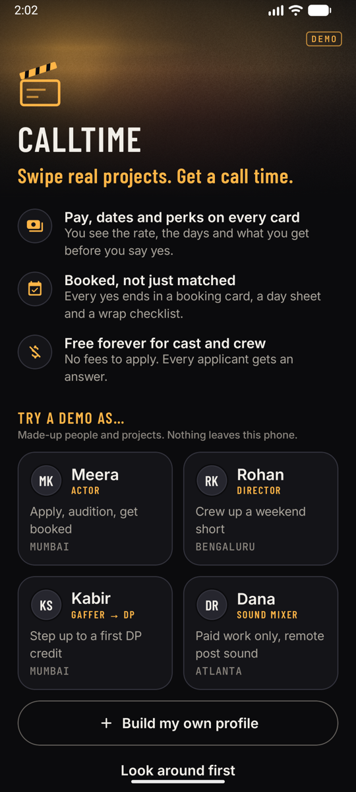
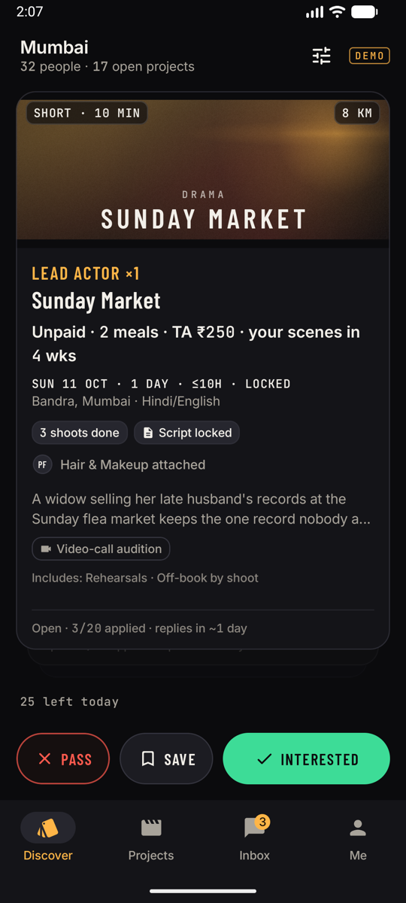
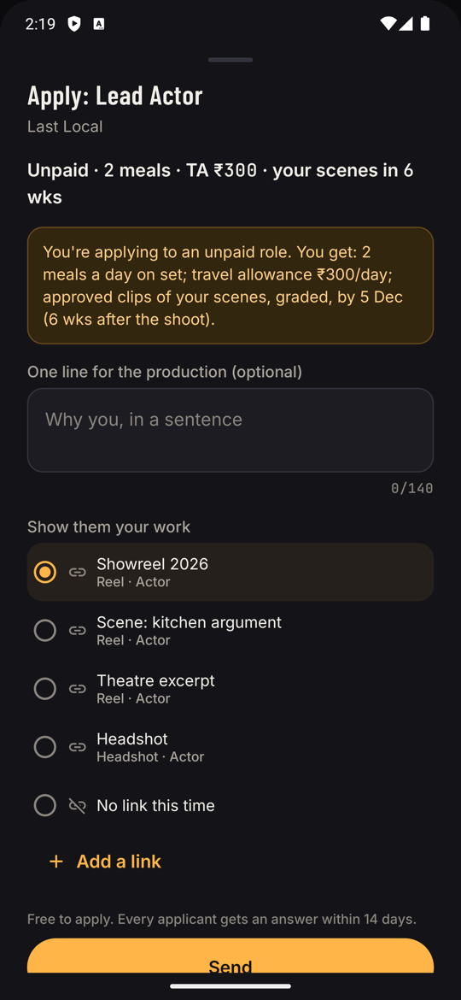
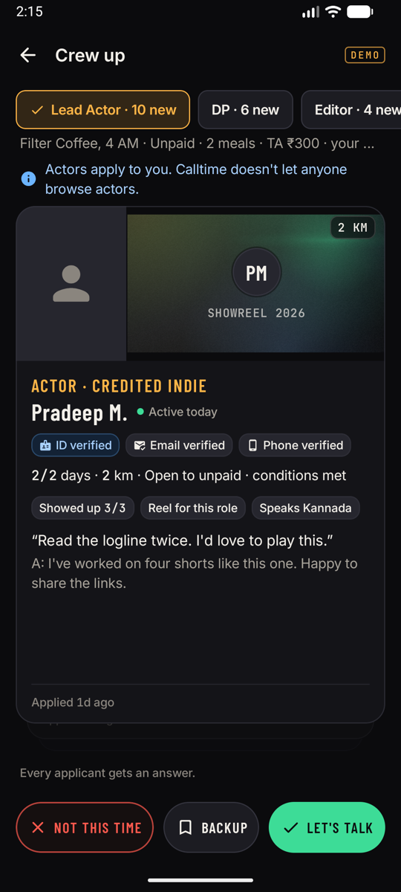
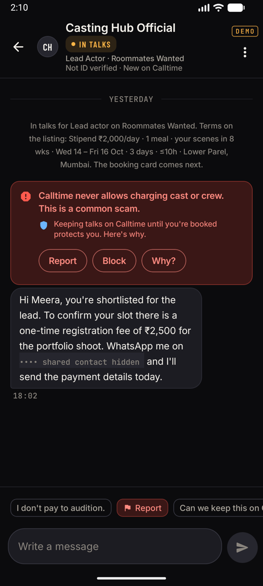
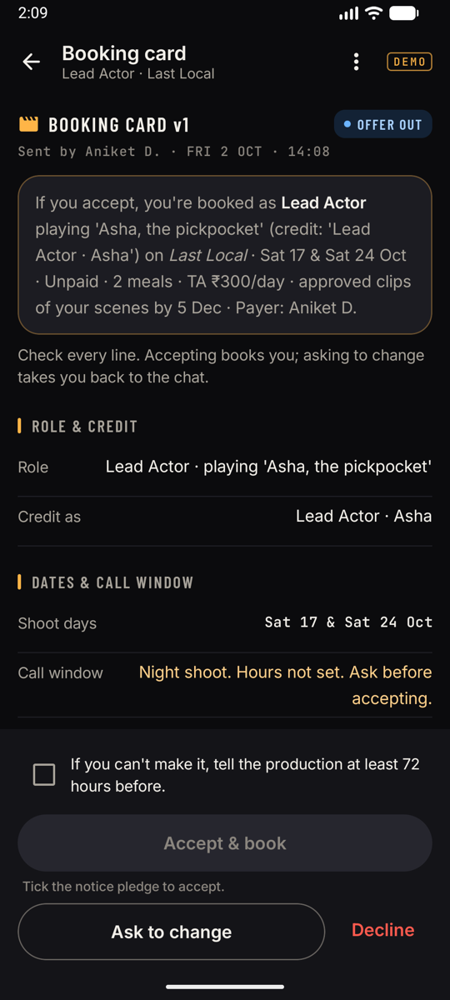
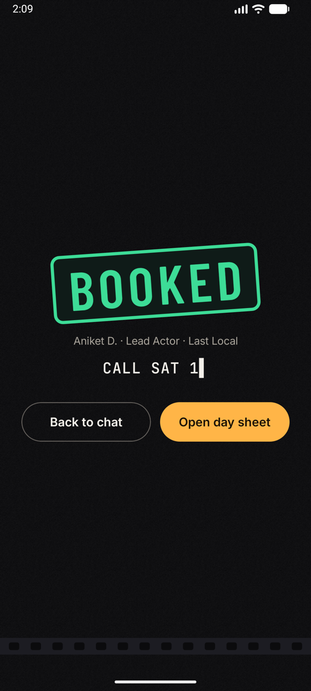
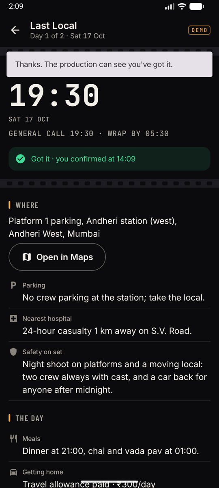
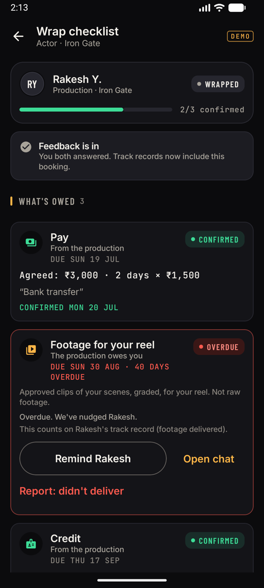

# Calltime

**Swipe real projects. Get a call time.**

Calltime is a free Android app that helps indie filmmakers crew up: actors, DPs, sound mixers, editors, composers, ADs and everyone else. It started from a working title, "Tinder for filmmakers", and from one question: *what actually goes wrong when indie filmmakers try to find each other?* We read hundreds of Reddit threads to find out, then built the app around the answers.

> **Status:** MVP, v0.1. It runs fully offline in **demo mode** with seeded people and projects. **Live mode** runs on Supabase; the schema, security rules and server functions are tested end to end against a local Supabase.

<table>
<tr>
<td></td>
<td></td>
<td></td>
</tr>
<tr>
<td align="center"><sub>Welcome: four demo personas</sub></td>
<td align="center"><sub>One card = one role. Pay first.</sub></td>
<td align="center"><sub>Apply: what you actually get</sub></td>
</tr>
<tr>
<td></td>
<td></td>
<td></td>
</tr>
<tr>
<td align="center"><sub>Crew up: ranked, no faces for crew</sub></td>
<td align="center"><sub>Fee scams flagged, contacts masked</sub></td>
<td align="center"><sub>Booking card: "If you accept…"</sub></td>
</tr>
<tr>
<td></td>
<td></td>
<td></td>
</tr>
<tr>
<td align="center"><sub>Booked, not just matched</sub></td>
<td align="center"><sub>Day sheet that works over WhatsApp</sub></td>
<td align="center"><sub>Wrap: footage and pay tracked like invoices</sub></td>
</tr>
</table>

## Why it exists

We ran a 9-angle study of Reddit's filmmaking communities (r/Filmmakers, r/acting, r/cinematography, r/LocationSound, r/filmscoring, r/indianFilmmakers, city subs and others). It came to about 230 unique threads, with comments, between 2023 and 2026. The full report is in [`research/REDDIT_RESEARCH.md`](research/REDDIT_RESEARCH.md), with per-angle notes in [`research/raw/`](research/raw/). In short:

1. **The job isn't "find people", it's "make the shoot happen and keep the promises".** Open crew calls get dozens of "DM me" replies and still never become shoots.
2. **Pay hidden behind "collab", "exposure" or "DM for details" kills trust.** People want the pay line first.
3. **The worst broken promises come after the shoot.** Footage, credit and pay never arrive. "The footage is our pay," as actors put it.
4. **Flaking runs both ways.** Crews vanish five days out, and productions ghost actors at call time.
5. **Scams follow detectable patterns.** They move the chat off-platform, ask talent for "registration fees", or set auditions in private homes.
6. **Existing platforms fall short.** Paid boards charge job-seekers, Facebook groups bury posts, and earlier swipe apps died of empty rooms and a dating-app vibe.

## What Calltime does about it

- **One card = one role on one project.** Every card leads with pay, dates and perks ("₹2,500/day + ₹1,000 kit · paid on wrap", or an honest "Unpaid · 2 meals · your scenes in 6 wks"). There are no faces on crew cards and no dating language: you're **Interested** or you **Pass**.
- **Hard gates before ranking.** You never see a role that fails your role, distance, dates, pay floor, content limits or language. A 0–100 fit score then ranks the rest, as specified in PRD §7.
- **Fewer, better applications.** There are 25 likes a day, application caps per role, ranked shortlists with reasons for the person hiring, and a promise that every applicant gets an answer within 14 days.
- **A match means "IN TALKS", not "it's a match".** Chat opens with the terms already summarised.
- **Two-tap booking card.** The payer sends plain-language terms. Accepting means pledging 72 hours' notice if you drop out, and any later change needs re-acceptance, with the changed fields shown as a diff.
- **Day sheet that works over WhatsApp.** It has call times, a tappable address, parking and the nearest hospital, "Got it" acknowledgements, and a "Still coming?" check 48 hours before.
- **A wrap checklist that treats footage and credit like invoices.** Paid, footage, final film and credit each get a due date, and both sides confirm them. Post-production roles get their own loop: they deliver against a date and are paid from delivery.
- **Facts-only, double-blind reputation.** Cards show things like "Paid on time 11/12", "Kept bookings 6/6" and "Showed up 9/9", and only once there are at least 3 data points. Both sides are accountable.
- **Safety by design.** Contacts are masked until you're booked, on the device and on the server. Scam-pattern warnings work in English and Hinglish. Audition requests are locked to the mode the listing declared, with in-person auditions only between 08:00 and 21:00 and never alone. There's one-tap report and block, a Safety Center, and badges that never say "verified project".
- **Built for India first.** It's Android, works by area and language, handles weekend-only crews, and has early-city support plus remote post roles open India-wide. It also works in the US and UK.
- **Free for talent, forever.** There are no fees to apply and no gen-AI on your work. See *How Calltime makes money* in the app.

The full product spec, which a persona panel stress-tested, is [`research/PRD.md`](research/PRD.md).

## Try it

### Install the APK
Build it (see below) or grab `app/build/outputs/apk/release/app-release.apk`. It is debug-signed so it installs directly (enable "Install unknown apps"). With no backend configured, it opens in **demo mode**.

### Demo mode
On the Welcome screen, pick a persona or build your own profile:

| Persona | Who | Try this |
|---|---|---|
| **Meera** | Actor, Versova, Mumbai | Swipe gigs, apply, do a self-tape audition, accept a booking, read the day sheet; open the "Casting Hub Official" chat to see scam protection |
| **Rohan** | Writer-director, Jayanagar, Bengaluru | Crew up *Filter Coffee, 4 AM*: applicants, Let's talk, booking cards; fix and publish a draft; post a project |
| **Kabir** | Gaffer stepping up to DP, Mumbai | Step-up DP roles; owner track records |
| **Dana** | Paid-only sound mixer, Atlanta | Paid-only deck in $; the post-production delivery loop on *Soft Light* |
| **Build my own** | You | Full onboarding. Try Indore to see the early-city experience |

**Settings → Demo controls** lets you switch persona, reset, change simulation speed, move the clock (+1/+7/+30 days, jump past the shoot or the wrap), inject a scam message, or simulate a crew withdrawal. The other side of every conversation is simulated, so the whole loop runs offline in about five minutes.

## Build from source

Requirements: JDK 17+ (Android Studio's bundled JBR works), Android SDK with **platform 37**, and a device or emulator on Android 8.0+ (minSdk 26).

```bash
echo "sdk.dir=$HOME/Library/Android/sdk" > local.properties
./gradlew assembleDebug            # app/build/outputs/apk/debug/app-debug.apk
./gradlew testDebugUnitTest        # unit tests
./gradlew assembleRelease          # app/build/outputs/apk/release/app-release.apk
```

Stack: Kotlin 2.4, Jetpack Compose with Material 3 (BOM 2026.09), type-safe Navigation Compose, kotlinx-serialization, coroutines and Flow, Coil 3, and supabase-kt 3.8 (Auth, PostgREST, Realtime) on Ktor/OkHttp. AGP 9.4, Gradle 9.8.

## Live mode (Supabase)

Live mode turns on when `local.properties` has a Supabase URL and key:

```properties
SUPABASE_URL=http://10.0.2.2:54321     # local Supabase, as seen from the Android emulator
SUPABASE_ANON_KEY=<anon key>
SHARE_BASE_URL=                        # optional, e.g. https://calltime.app (blank = Play Store line in shared posts)
```

Everything is in [`supabase/`](supabase/):
- **Migrations:** every table, row-level security on all of them, and security-definer RPCs for the whole loop. That covers discovery, applying, deciding, scouting, asks, auditions, booking cards, shoot days, wrap, feedback and reputation.
- **`seed.sql`:** reference cities. People are never seeded into Supabase.
- **`tests/live_e2e.py`:** a two- and three-user end-to-end test over the real API, including the RLS checks. It passes 166 of 166.

See [`supabase/README_SUPABASE.md`](supabase/README_SUPABASE.md) to run it locally (`npx supabase start`) or deploy it to a free Supabase project.

## Architecture

```
app/src/main/java/com/tff/app
├─ model/        data contract: enums, role taxonomy (29 roles), models
├─ data/Repo.kt  the single Repo interface every screen uses
├─ data/demo/    DemoRepo: deterministic seed (80 people, 20 cities), JSON store, simulator
├─ data/remote/  SupabaseRepo: DTOs, mappers, Realtime
├─ domain/       pure Kotlin: MatchEngine, ApplicantRanker, ListingRules (R01–R22),
│                MessageSafety, booking terms/diff/wrap, ReputationCalc, card + share copy
├─ ui/theme      "darkroom" tokens: Barlow Condensed / Inter / JetBrains Mono
├─ ui/components SwipeDeck, RoleCard, PersonCard, overlays, sheets, forms
├─ ui/screens/   Discover · Role · Crew up · Person · Post wizard · Projects · Inbox · Chat ·
│                Booking · Shoot day · Wrap · Onboarding · Me · Safety · Settings
└─ nav/, di/     type-safe routes + deep links (calltime://r|m|p/{id}), manual DI
```

Matching and ranking run on the device in both modes. The server only returns candidates, so a private minimum rate never reaches anyone else's phone.

## Quality

| Layer | Result |
|---|---|
| Unit tests (`./gradlew testDebugUnitTest`) | **337 / 337** pass: matching gates and the worked example in PRD §7.5, the ranker, all 22 listing rules, scam and contact detection in English and Hinglish, booking diffs, wrap items, reputation, demo-seed compliance, and the demo engine's state machine |
| Demo end to end (`qa/run_qa.py`, PRD §15.3 steps 1–11) | Every step passes on an **Android 16** phone emulator and an **Android 14** Pixel 7 Pro emulator. Details in [`qa/QA_REPORT.md`](qa/QA_REPORT.md) |
| Live server end to end (`supabase/tests/live_e2e.py`) | **166 / 166** checks, including RLS, masking and the full booking loop |
| Live app with two real people (`qa/live_peer.py`) | Collaborator, owner and session/safety flows pass on a device. See [`qa/LIVE_QA.md`](qa/LIVE_QA.md) |

Before release, a design critic and a filmmaker-persona panel (an actor, a director, a paid-only sound mixer and a first-timer in Indore) reviewed every screen. All their P0 and P1 issues are fixed. Engineering conventions for contributors are in [`docs/BUILD_GUIDE.md`](docs/BUILD_GUIDE.md).

## Roadmap (not in the MVP)

- Payments and escrow
- Push via FCM, and a background poller for closed-app notifications in live mode
- Pencil holds
- Team group threads
- Crew packages, where a DP applies with their crew
- Challenge mode for 48-hour and 50-hour film lobbies
- Hindi and regional UI languages
- Concierge ID-check tooling
- iOS and web

PRD §4.3 lists everything deferred, with reasons.

## Notes

- Research data: quotes are short and paraphrased where possible, no Reddit usernames are recorded, and nothing was posted to Reddit. The research is used only to design this product.
- Fonts: Barlow Condensed, Inter and JetBrains Mono, all under the SIL Open Font License.
- Demo people, projects and companies are fictional.
